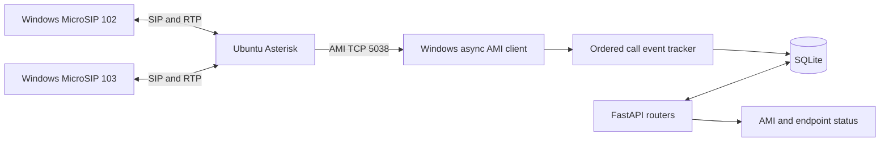

# CallFlow API

CallFlow is a free local FastAPI telecommunications backend that observes real Asterisk calls through AMI and persists call history in SQLite. SIP clients handle audio; the API tracks signalling, call state, timing, endpoints, agents, customers, and reports. SSH is used only for Ubuntu administration.

The tested environment runs **Asterisk 20.6.0 on an Ubuntu 24.04.3 LTS VM**, with **FastAPI and two portable MicroSIP clients on Windows**. The setup below builds that environment from scratch. Existing working PBX installations can use the verification commands without replacing their configuration.

## Architecture and repository



The stack is Python (tested with 3.13), FastAPI, Pydantic 2, SQLAlchemy 2, SQLite, Uvicorn, and python-dotenv. The AMI client uses Python asyncio streams; pytest and HTTPX support offline tests. Exact installed-package versions are pinned in `requirements.txt`.

```text
app/
  main.py              FastAPI lifespan, health, router registration
  config.py            Environment configuration
  database.py          SQLite engine, foreign keys, sessions
  migrations.py        Original-schema upgrade and initialization
  models.py            Agent, Customer, Call, CallChannel, Endpoint
  schemas.py           Pydantic request/response models
  ami.py               Authentication, framing, heartbeats, retries, listener lock
  telephony.py         Correlation, states, durations, recovery
  routers/
    agent.py customer.py call.py report.py asterisk.py
sql/procedures.sql     Educational SQL Server examples, not runtime migrations
tests/                 Isolated API, event, protocol, database, migration tests
test_ami.py            Explicit AMI login probe
.env.example           Configuration template without working credentials
IMPLEMENTATION.md      Implementation history and repository-readiness assessment
requirements.txt       Pinned Python dependencies
```

## Setup from scratch

### Stage 1 — Prerequisites

| Free tool | Role and location |
|---|---|
| [Oracle VirtualBox](https://www.virtualbox.org/wiki/Downloads) | Runs the Ubuntu VM on Windows; its Extension Pack is not required |
| [Ubuntu](https://ubuntu.com/download/desktop) | VM guest OS; tested with 24.04.3 LTS, available through Ubuntu's older-release links when needed |
| [Python](https://www.python.org/downloads/windows/) | Runs FastAPI on Windows; use Python 3.13 to match the validated environment |
| [Git](https://git-scm.com/downloads) | Clones the repository and reviews changes |
| Asterisk | Free PBX installed inside Ubuntu in Stage 4 |
| [MicroSIP](https://www.microsip.org/) | Two Windows SIP endpoints; portable downloads are used in Stage 8 |
| OpenSSH | Windows SSH client and Ubuntu SSH server for administration |
| Python packages | Installed into a virtual environment from `requirements.txt` in Stage 11 |

Enable hardware virtualization in BIOS/UEFI if VirtualBox requires it. Download the Ubuntu ISO, install VirtualBox, and ensure Windows has Git, Python with the Python launcher, and the OpenSSH Client optional feature. Check in PowerShell:

```powershell
py -3.13 --version
git --version
ssh -V
```

Three command environments are used throughout this guide:

- **Windows PowerShell:** Git, Python/FastAPI, SSH client, and network probes.
- **Ubuntu terminal:** `sudo`, `apt`, `systemctl`, and configuration editing. An SSH session from PowerShell is also an Ubuntu terminal after login.
- **Asterisk CLI:** the `*CLI>` prompt entered with `sudo asterisk -rvvv`. Enter commands such as `pjsip show contacts` without `sudo asterisk -rx`. Type `exit` to detach from the CLI without stopping Asterisk.

### Stage 2 — Create Ubuntu VM and configure networking

1. In VirtualBox, create a new Linux/Ubuntu 64-bit VM and attach the downloaded ISO. A practical starting allocation for Ubuntu Desktop is 2 virtual CPUs, 4 GB RAM, and a 25 GB dynamically allocated disk; increase these if your chosen Ubuntu release needs more resources.
2. Boot the ISO, follow the Ubuntu installer, create a local username/password, and install onto the VM's virtual disk. Reboot and detach the ISO after installation.
3. With the VM powered off, configure **Adapter 1: NAT** for Ubuntu internet/package access. Configure **Adapter 2: Host-only Adapter**, selecting the host-only network created through VirtualBox's network manager. Ensure both virtual cables are connected. No NAT port forwarding is needed.
4. Start Ubuntu and inspect addresses:

```bash
hostname -I
ip addr
```

The tested lab used these example addresses:

```text
Ubuntu NAT IP:       10.0.2.15
Ubuntu Host-only IP: 192.168.56.101
Windows Host-only:   192.168.56.1
```

Use `ipconfig` in Windows PowerShell to identify the Windows host-only adapter. Your addresses may differ. Record the actual **Ubuntu host-only IPv4 address** and **Windows host-only IPv4 address**. Use them consistently in SSH, MicroSIP, AMI binding/ACLs, firewall rules, and `.env`; do not use the NAT address for Windows-to-PBX connections. Use a DHCP reservation or a suitable static host-only address if it changes between VM starts. Replace angle-bracket placeholders below before running commands or saving configuration.

### Stage 3 — Configure SSH administration

In the Ubuntu terminal:

```bash
sudo apt update
sudo apt install openssh-server -y
sudo systemctl enable --now ssh
sudo systemctl status ssh
```

Press `q` to leave the status pager. From Windows PowerShell, substitute your username and recorded host-only address:

```powershell
ssh <ubuntu-username>@<ubuntu-host-only-ip>
```

Confirm the first connection's host fingerprint against the VM before accepting it. SSH administers Ubuntu and edits Asterisk configuration; the application itself communicates with Asterisk through **AMI**, not SSH.

### Stage 4 — Install and verify Asterisk

In the Ubuntu terminal:

```bash
sudo apt update
sudo apt install asterisk -y
sudo systemctl enable --now asterisk
asterisk --version
sudo systemctl status asterisk
sudo asterisk -rvvv
```

The documented lab was tested with **Asterisk 20.6.0 on Ubuntu 24.04**. `apt` installs the version offered by your enabled repositories, which may differ; verify the reported version rather than assuming this command pins 20.6.0. At the Asterisk `*CLI>` prompt, try `core show version`, then `exit` to return to Ubuntu.

### Stage 5 — Back up Asterisk configuration

Before editing, preserve the supplied configuration so it can be compared or restored:

```bash
sudo cp -n /etc/asterisk/pjsip.conf /etc/asterisk/pjsip.conf.backup
sudo cp -n /etc/asterisk/extensions.conf /etc/asterisk/extensions.conf.backup
sudo cp -n /etc/asterisk/manager.conf /etc/asterisk/manager.conf.backup
```

`-n` keeps an existing backup from being overwritten on a second run. If you need another snapshot, use a different backup name. Keep these files on the VM; they can contain credentials and do not belong in this repository.

### Stage 6 — Configure PJSIP extensions 101, 102, and 103

Edit `/etc/asterisk/pjsip.conf`, for example with `sudo nano /etc/asterisk/pjsip.conf`. Merge the following into your configuration and avoid conflicting duplicate endpoint or transport definitions. One endpoint and one AOR intentionally share the extension's section name; their `type` distinguishes them.

```ini
[transport-udp]
type=transport
protocol=udp
bind=0.0.0.0:5060

[102]
type=endpoint
context=internal
disallow=all
allow=ulaw
aors=102
auth=auth102
transport=transport-udp
callerid=Agent 102 <102>
direct_media=no
rewrite_contact=yes
rtp_symmetric=yes
force_rport=yes

[auth102]
type=auth
auth_type=userpass
username=102
password=REPLACE_WITH_102_LOCAL_SIP_PASSWORD

[102]
type=aor
max_contacts=1
remove_existing=yes
qualify_frequency=30
```

Create equivalent **endpoint, authentication, and AOR** sections for **101** and **103**: replace each `102` with the new extension, including `aors`, `auth`, the authentication section name, username, and caller ID. Assign a distinct local SIP password to each. These placeholders are not working credentials. All three extensions are configured; **102 and 103** are used for calls. Do not assume 101 is registered.

`transport` selects UDP signalling; `auth` links credentials; `aors` links registration/contact information. `max_contacts=1` supports one client per extension; `remove_existing=yes` replaces its previous contact when registering again. Qualification checks reachability every 30 seconds. `direct_media=no` keeps media through Asterisk; the remaining contact/RTP/rport settings help return traffic reach the registering client. The caller ID text is a SIP display label, not an application agent assignment.

The wildcard bind listens on all VM interfaces. Keep it inside the isolated lab with firewall restrictions, or bind to your actual Ubuntu host-only IP instead. Inspect `/etc/asterisk/rtp.conf` for the actual media port range. If using UFW, inspect existing rules before adding narrowly scoped rules; for example, in Ubuntu:

```bash
sudo ufw status
read -r -p "Windows host-only IPv4: " WINDOWS_HOST_IP
read -r -p "Ubuntu host-only IPv4: " UBUNTU_HOST_IP
sudo ufw allow from "$WINDOWS_HOST_IP" to "$UBUNTU_HOST_IP" port 5060 proto udp
# Example only: use the range configured in rtp.conf.
sudo ufw allow from "$WINDOWS_HOST_IP" to "$UBUNTU_HOST_IP" port 10000:20000 proto udp
```

Do not enable a firewall remotely without ensuring your SSH access is allowed. Additional physical SIP devices need rules for their own lab addresses. Do not expose SIP/RTP or AMI through public port forwards.

For endpoint/auth/AOR edits, reload and inspect:

```bash
sudo asterisk -rx "pjsip reload"
sudo asterisk -rx "pjsip show endpoints"
sudo asterisk -rx "pjsip show contacts"
```

A **configured endpoint** is a loaded PBX definition. A **registered contact** is the address of a client that registered against its AOR. A **reachable/available endpoint** additionally needs a usable contact and appropriate device state. Configured endpoints can have no contacts. Qualification can take time after registration.

Transport changes normally require `sudo systemctl restart asterisk` with the default `allow_reload=no`; a PJSIP reload alone does not apply them. Restart only when lab calls can be interrupted. Recheck endpoints and contacts after restart. See the [Asterisk section/transport reference](https://docs.asterisk.org/Configuration/Channel-Drivers/SIP/Configuring-res_pjsip/PJSIP-Configuration-Sections-and-Relationships/).

### Stage 7 — Configure the internal dialplan

Edit `/etc/asterisk/extensions.conf` and add or merge this context:

```ini
[internal]

exten => 101,1,NoOp(Call to extension 101)
 same => n,Dial(PJSIP/101,30)
 same => n,Hangup()

exten => 102,1,NoOp(Call to extension 102)
 same => n,Dial(PJSIP/102,30)
 same => n,Hangup()

exten => 103,1,NoOp(Call to extension 103)
 same => n,Dial(PJSIP/103,30)
 same => n,Hangup()
```

Apply and verify from Ubuntu:

```bash
sudo asterisk -rx "dialplan reload"
sudo asterisk -rx "dialplan show internal"
```

An incoming call from an endpoint uses its `context=internal`. Dialling 103 selects that extension's priorities, logs the NoOp message, rings the registered PJSIP/103 contact for up to 30 seconds, and then hangs up when Dial returns.

### Stage 8 — Install two isolated portable MicroSIP clients

Download the free **portable ZIP** from the [official MicroSIP downloads page](https://www.microsip.org/downloads). Extract independent copies outside the repository, for example `C:\SIPLab\MicroSIP-102` and `C:\SIPLab\MicroSIP-103`. Launch each directory's executable. Keep each portable instance's own settings/INI and account data in its directory; do not share a settings file or merely switch accounts in one running client. Check that both independent windows remain open and retain their own accounts after restart.

Configure these account fields:

| Field | Instance A | Instance B |
|---|---|---|
| Account label | Lab 102 | Lab 103 |
| SIP server | Actual Ubuntu host-only IP | Actual Ubuntu host-only IP |
| Domain | Same Ubuntu host-only IP | Same Ubuntu host-only IP |
| Username / Login | 102 / 102 | 103 / 103 |
| Password | Local SIP password for 102 | Local SIP password for 103 |
| SIP Proxy | Leave blank | Leave blank |
| Transport | UDP | UDP |
| Public Address | Auto/default | Auto/default |
| Local port | 5062 | 5063 |

Set distinct **local** SIP ports in each account's settings (for example 5062 and 5063). The **remote server** remains on port 5060; do not change the server/domain port just to separate local clients. Permit both executables through Windows Firewall on the profile assigned to the host-only adapter, restricting rules to the VM's address; an unidentified adapter may not use the Private profile. Avoid STUN/public-address overrides for this direct host-only lab unless a trace establishes they are needed. With multiple Windows interfaces, confirm the registered contacts advertise the reachable Windows host-only address and distinct ports. The [MicroSIP account documentation](https://www.microsip.org/help) describes its Local port and address settings.

Confirm both clients show registered/online, then check Ubuntu:

```bash
sudo asterisk -rx "pjsip show endpoints"
sudo asterisk -rx "pjsip show contacts"
```

Expect contacts for 102 and 103 and reachable status after qualification. SIP passwords authenticate the telephone clients and are separate from the AMI password configured in Stage 10.

### Stage 9 — Verify a SIP call and normal hangup

1. Ensure Asterisk is running and both MicroSIP instances are open and registered.
2. Dial **103 from 102** and answer in the separate 103 window.
3. Keep the call connected briefly and verify audio in both directions.
4. Use the hangup button on one client; verify the other client disconnects too.
5. Confirm Asterisk has no remaining channels for this call:

```bash
sudo asterisk -rx "core show channels"
sudo asterisk -rx "core show channels concise"
```

In an otherwise idle lab, expect zero active channels. A normal answered SIP dialogue commonly follows:

```text
INVITE
100 Trying
180 Ringing
200 OK
ACK
BYE
200 OK
```

Provisional responses vary (for example, 183 may be used). Registration commonly starts with REGISTER → **401 Unauthorized** digest challenge → authenticated REGISTER → 200 OK; an initial 401 is not itself a failure. INVITE authentication can also involve a challenge and retry. Repeated challenges without a successful authenticated request need investigation.

The maintainer reports that the tested setup **successfully demonstrated normal SIP hangup signalling after troubleshooting**, using separate portable clients. This is a reported lab result, not a new live-call test performed during the documentation review. Earlier retained channels and their controlled cleanup are recorded historically in [IMPLEMENTATION.md](IMPLEMENTATION.md). If hangup leaves channels behind, investigate the SIP dialogue using the troubleshooting section; do not automate AMI termination to hide the problem.

### Stage 10 — Configure Asterisk Manager Interface (AMI)

AMI carries events from Asterisk to the FastAPI integration and supports permitted management actions. The application uses observation/snapshot actions, not call-control or SSH commands. Edit `/etc/asterisk/manager.conf` and replace both IP placeholders and the password before loading:

```ini
[general]
enabled=yes
port=5038
bindaddr=<ubuntu-host-only-ip>

[callflow]
secret=REPLACE_WITH_LOCAL_AMI_SECRET
deny=0.0.0.0/0.0.0.0
permit=<windows-host-only-ip>/255.255.255.255
read=system,call,reporting
write=system,reporting
```

The host-specific permit restricts the account to the Windows machine. The observer sends Login, Ping, CoreShowChannels, PJSIPShowContacts, and DeviceStateList. Do not grant `command` or `originate` for this application. Check privileges against your installed Asterisk action help if a snapshot is denied.

From Ubuntu:

```bash
sudo asterisk -rx "manager reload"
sudo asterisk -rx "manager show users"
sudo asterisk -rx "manager show user callflow"
sudo ss -lntp | grep 5038
```

If UFW is used, allow TCP 5038 only from your recorded Windows host-only IP to Ubuntu's host-only IP, using the same variables as Stage 6:

```bash
sudo ufw allow from "$WINDOWS_HOST_IP" to "$UBUNTU_HOST_IP" port 5038 proto tcp
```

Set those variables again if this is a new terminal. In Windows PowerShell, use your actual address:

```powershell
$UbuntuHostOnlyIp = Read-Host "Ubuntu host-only IPv4 address"
Test-NetConnection -ComputerName $UbuntuHostOnlyIp -Port 5038
```

For the tested lab address, that probe is `Test-NetConnection 192.168.56.101 -Port 5038`. TCP success does not prove authentication; run the project's login probe after installing dependencies and configuring `.env` in Stage 11. AMI uses plain TCP in this isolated lab. Do not expose port 5038 publicly or commit credentials.

### Stage 11 — Set up and launch FastAPI on Windows

In PowerShell, clone the repository and enter its root:

```powershell
git clone https://github.com/OdCool27/CallFlow-API.git
Set-Location CallFlow-API
py -3.13 -m venv .venv
.\.venv\Scripts\Activate.ps1
python -m pip install -r requirements.txt
if (-not (Test-Path -LiteralPath .env)) { Copy-Item .env.example .env }
notepad .env
```

If your PowerShell policy blocks activation, use `.\.venv\Scripts\python.exe` in place of `python` for every command below; activation is optional and no system policy change is necessary.

In `.env`, set `AMI_HOST` to the VM's actual host-only address; set AMI username/secret to match `manager.conf`. Keep `DATABASE_URL=sqlite:///./callflow.db` for the default local database, and set `AMI_ENABLED=true` for the real PBX. The template contains placeholders, not working credentials. Keep any existing local `.env` and edit it rather than replacing it. See the configuration table below for every key.

Authenticate explicitly:

```powershell
python test_ami.py
```

The probe prints the AMI banner and authentication success, then logs off. It is not run by pytest. If AMI is unavailable, fix connectivity or set `AMI_ENABLED=false` to use nontelephony operations without a PBX; the probe itself always attempts a connection when invoked.

No separate migration CLI or Alembic command is required: startup calls `initialize_database(engine)` automatically. On a new clone it creates the SQLite file/tables and schema version 1. Against the original schema it first saves a backup and upgrades existing rows. Stop other API processes before an upgrade. Keep the current directory at the repository root so `.env` and the relative database path resolve as documented. If choosing a database in a subdirectory, create that directory first.

Start the app:

```powershell
python -m uvicorn app.main:app --host 127.0.0.1 --port 8000
```

Open [Swagger UI](http://127.0.0.1:8000/docs); machine-readable schemas are at `/openapi.json` and ReDoc at `/redoc`. Use **exactly one worker**. `--reload` is optional for development; it interrupts observation, so affected calls become incomplete. A database-specific OS lock prevents duplicate listeners; another process reports `listener_owned_elsewhere`. Do not run listeners using different databases against the same PBX. Stop the server with Ctrl+C; `deactivate` exits an activated virtual environment.

### Stage 12 — Demonstrate the complete integration

1. Start the VM; verify the Asterisk service, endpoints/contacts, and TCP 5038 access. Run the AMI login probe from Windows.
2. Start FastAPI. GET `/health` should report `status=healthy`, `database=connected`, `version=2.0.0`. GET `/asterisk/status` should report `enabled=true`, `connected=true`, `synchronized=true`, and `state=connected`. API health is independent of PBX availability.
3. Register both portable clients and check `/asterisk/endpoints`. Reachable contact plus `NOT_INUSE` should produce `available=true`; it does not create or log in an application agent.
4. Before calling, optionally POST `/agents` with `{"name":"Demo Agent","extension":"103","department":"Support"}`. Save the returned ID; reuse an existing assignment if creation returns 409. Agent attribution occurs during event processing, so create the assignment before the demo call.
5. Dial **103 from 102**. GET `/calls/active` while ringing, then after answering. Expect one logical call progressing through ringing/answered/in-progress states, not one business record per channel. Fast transitions may be too brief to see by polling.
6. Speak briefly, hang up normally, and verify the other client disconnects. Run both `core show channels` commands from Stage 9 to confirm the call's channels have ended.
7. GET `/calls?extension=103` and `/calls/{id}`. The new record should have `source=AMI`, `direction=INTERNAL`, `status=COMPLETED`, `disposition=COMPLETED`, a `linked_id`, timestamps, timing fields, and the assigned `agent_id` if configured. `customer_id` remains null until explicitly linked. Check `tracking_incomplete=false` for a continuously observed test.
8. Confirm `/calls/active` no longer includes it, then check `/reports/calls`, `/reports/agents`, and `/reports/agents/{id}/statistics`. The average uses measured connected duration, excluding incomplete/legacy observations. No ringing time counts as conversation duration.
9. Restart FastAPI and retrieve the call again to confirm persistence. For a read-only SQLite inspection, run the following from the repository root (it respects your configured database):

```powershell
python -c "from app.database import engine; from sqlalchemy import text; c=engine.connect(); print(c.execute(text('SELECT id, linked_id, status, agent_id, connected_seconds FROM calls ORDER BY id DESC LIMIT 5')).mappings().all()); c.close()"
```

One telephone call normally has two Asterisk channels. Linkedid and Uniqueid/Dial relationships correlate them; bridge membership measures connection time. The API returns call records, not a separate channel-history route. Call timings use AMI receive time and are approximate.

Optional follow-up scenarios: let ringing reach the 30-second dial timeout for NO_ANSWER; cancel before answer for CANCELLED; reject with a busy response for BUSY (PBX/SIP causes determine the exact result). During a lab-only network outage, nontelephony operations remain available, retry attempts are bounded, and affected calls become incomplete. Restore connectivity before exhaustion or restart the API afterward. Only interrupt the VM/network when interrupting lab calls is acceptable.

## Environment variables

| Setting | Default without .env | Purpose |
|---|---|---|
| APP_ENV | development | Environment label; does not add authentication or change network binding |
| LOG_LEVEL | INFO | Standard Python logging level |
| DATABASE_URL | sqlite:///./callflow.db | SQLite file relative to working directory; other database engines are not supported by this runtime |
| AMI_ENABLED | false | Set true to observe the PBX; template enables it |
| AMI_HOST | 192.168.56.101 | Host-only address of Ubuntu |
| AMI_PORT | 5038 | AMI TCP port |
| AMI_USERNAME | callflow | AMI account name |
| AMI_SECRET | empty | Required when AMI is enabled; never returned by the API |
| AMI_TIMEOUT | 5 | Connection/login/heartbeat timeout in seconds |
| AMI_RECONNECT_ATTEMPTS | 5 | Maximum session attempts per application lifespan, including first connection |
| AMI_RECONNECT_DELAY | 2 | Initial retry delay; doubles up to 30 seconds |

After the attempt budget is exhausted, `/asterisk/status` reports `exhausted`. Fix connectivity/configuration and restart the API. A channel snapshot must complete within the larger of 15 seconds or three times AMI_TIMEOUT.

## Database and existing work

SQLite was already the working database, so it is retained. No SQL Server installation, paid service, or Docker container is required. Initialization runs in application startup, not on import.

The original agents and customers are preserved. An agent's unique numeric extension is an explicit application assignment; an endpoint is never automatically made an agent or customer. Agent department is optional at the API and stored as an empty string if omitted, preserving the original database constraint.

A call can have an optional agent and customer. Normal internal calls use direction `INTERNAL`; direction inference for external trunks is not implemented. The called extension's assigned agent takes precedence, otherwise the originating extension's agent is used. This is single-agent attribution, not a queue login or transfer participation model. Customer association is explicit through PATCH; matching caller ID to a customer automatically would be unreliable.

Calls store a unique Asterisk Linkedid, UTC timestamps, status, disposition, timing fields, source, and an incomplete-tracking flag. `call_channels` persists Uniqueid, channel name, extension, bridge, and hangup time. Foreign keys are enabled. Call identifiers, agent, extension, status, timestamps, channel membership, and bridge lookups have indexes.

On first launch against the **original** schema, `app/migrations.py`:

1. Saves `callflow.db.pre-ami.bak` (or the equivalent configured path) using SQLite's backup API.
2. Rebuilds the calls table transactionally to allow unmapped calls and add AMI fields.
3. Preserves IDs, relationships, statuses, timestamps, and notes. Existing records become `source=LEGACY`, `tracking_incomplete=true`; historical conversation duration is unknown.
4. Creates channel/endpoint tables and indexes, and records schema version 1 using `PRAGMA user_version`.

New databases are created directly at version 1. Repeat initialization is safe; a newer unknown version is rejected. This is a focused original-to-v1 migration, not a general migration framework. Stop all API processes before upgrading or restoring a database. If migration fails, inspect the backup and error before retrying. A preexisting backup blocks another upgrade attempt to avoid overwriting it. To restore, stop the app, preserve the failed database for inspection, and copy the backup to the configured database path.

`sql/procedures.sql` remains a separate educational T-SQL script. LEFT JOIN summaries, aggregation, transactions, and indexes are reflected in the runtime implementation. Stored procedures, `DATEDIFF`, `GO`, and the example `call_logs` table are not executed by SQLite. Those examples reflect the old manually managed lifecycle; their start-to-end duration is elapsed time, not conversation time. SQLAlchemy report queries now average measured connected time.

## Call tracking and recovery

`Newchannel` starts a business call. Linkedid correlates channel legs; Uniqueid identifies each persisted leg. DialBegin/DialEnd explicitly associate destination channels and can merge independently observed channel groups. Extension numbers alone never correlate calls.

- `Newstate` Ring/Ringing records ringing.
- `DialEnd` ANSWER records answer; BUSY/NOANSWER/CANCEL/CHANUNAVAIL/CONGESTION supply final disposition.
- `BridgeEnter` with at least two live channels from the call starts measured connected time. Repeated bridge entries are idempotent.
- `BridgeLeave` or Hangup closes a measured interval when fewer than two call channels remain together. Later bridge re-entry can start another interval.
- Hangup finalizes only after all known call channels end. Duplicate/late events never reopen a finalized call.
- ContactStatus/ContactList and DeviceStateChange update endpoint status. Availability requires a reachable contact and `NOT_INUSE`, with a connected/synchronized observer. It does not imply agent login.

States are `INITIATED`, `RINGING`, `ANSWERED`, `IN_PROGRESS`, `COMPLETED`, `BUSY`, `NO_ANSWER`, `CANCELLED`, and `FAILED`. An answered call is completed after all legs end even if connected duration is zero. Unanswered calls use dial/hangup causes. An unobserved terminal outcome is `status=FAILED`, `disposition=UNKNOWN`, with incomplete tracking.

Durations (seconds):

| Field | Meaning |
|---|---|
| setup_seconds | Start to answer, or start to termination for unanswered calls; includes ringing |
| ringing_seconds | First ringing to answer/termination; null if ringing was not observed |
| connected_seconds | Sum of observed intervals with at least two live call channels sharing a bridge |
| total_seconds | First observed start to final observed/reconciled termination |

Ringing is never counted as connected time. Timestamps are stored and returned as naive **UTC**; interpret them as UTC, not Windows local time. AMI receive time is used, so timing is approximate and affected by delivery latency. Active call responses include the elapsed portion of the currently open observed bridge interval; persisted totals are updated when it closes. Final calls have complete measured totals unless flagged incomplete.

One coroutine reads AMI frames in order. Each database transaction runs in a worker thread and is awaited before the next event, keeping synchronous SQLite work off the FastAPI event loop. Startup/shutdown own exactly one listener; pings detect silent disconnections.

On disconnect or process restart, active AMI calls become incomplete and endpoint states become unknown. On login, CoreShowChannels reconstructs currently active channels. Previously active channels missing from a completed snapshot are closed at reconciliation time; if all legs disappeared the disposition is UNKNOWN. Calls active during recovery remain incomplete. Unobserved conversation time is never added. Incomplete and legacy calls are excluded from connected-duration averages.

AMI cannot replay calls that start and finish entirely during downtime. Exact recovery requires a future CDR/CEL backfill. A failed transaction tears down the session so recovery flags uncertainty rather than silently continuing with an unpersisted event.

## API reference

Full typed schemas are available at `/docs` and `/openapi.json`.

| Method | Path | Behavior |
|---|---|---|
| GET | `/` | API greeting |
| GET | `/health` | Real database check; 503 on database failure; independent of AMI |
| GET | `/health?field=status` | Known health field; unknown field returns 400 |
| GET | `/asterisk/status` | Connectivity, synchronization, attempts, last event; no credentials |
| GET | `/asterisk/endpoints` | Observed endpoints and explicitly assigned agent extensions; unknown states remain unavailable |
| POST / GET | `/agents` | Create/list agents; duplicate extension 409 |
| GET | `/agents/{id}` | Agent details or 404 |
| POST / GET | `/customers` | Create/list customers |
| GET | `/customers/{id}` | Customer details or 404 |
| GET | `/calls` | History filtered by status, agent_id, extension, start, end; limit 1-1000 and offset |
| GET | `/calls/active` | Unfinalized AMI calls; consult AMI status for freshness |
| GET | `/calls/{id}` | Call details and timing |
| PATCH | `/calls/{id}` | Edit notes/customer_id only; explicit null unlinks customer |
| POST | `/calls` | 409: call creation requires real PBX events |
| DELETE | `/calls/{id}` | Delete legacy records only; AMI history retained for correlation (409) |
| GET | `/reports/agents` | LEFT JOIN call counts including zero-call agents |
| GET | `/reports/agents/{id}/statistics` | Total/completed and average connected seconds; optional start/end |
| GET | `/reports/calls` | Counts by status and connected-time average; agent/extension/date filters |

Date ranges filter call **start** time: inclusive start and exclusive end. Supply ISO 8601 UTC or timezone offsets; naive values mean UTC. Reports include legacy counts, but exclude unknown/incomplete duration samples from averages. Missed call outcomes are visible as NO_ANSWER/CANCELLED/BUSY/FAILED rather than a single ambiguous MISSED state. To calculate answered versus missed outcomes, completed calls represent answered calls for normally finalized AMI records; inspect answered_at for incomplete or legacy cases.

Origination was considered and deliberately omitted: the local API has no authentication and needs no call-control permissions. Customer and agent creation are administrative local operations. Bind to localhost as shown; this is not a production or publicly accessible service.

## Automated tests

```powershell
.\.venv\Scripts\python -m pytest -q
.\.venv\Scripts\python -m compileall -q app tests test_ami.py
.\.venv\Scripts\python -m pip check
```

Tests disable AMI and use isolated in-memory SQLite databases. Migration tests use temporary files with an original-schema fixture and verify the backup, preserved rows, nullable associations, foreign keys, and repeat initialization. Synthetic AMI frames exercise protocol parsing and lifecycle behavior without a live PBX. Tests never create simulated calls in the application database.

The suite covers health, customer/agent operations, reports, real-call API restrictions, channel correlation/merging, duplicate events, bridge intervals, busy/no-answer/cancel/failure, disconnection reconciliation, bounded retries, and clean shutdown. The separate probe and manual steps above validate the real lab; automated test success alone does not establish an audio call.

## Troubleshooting

Use the [official Asterisk PJSIP troubleshooting guide](https://docs.asterisk.org/Configuration/Channel-Drivers/SIP/Configuring-res_pjsip/Asterisk-PJSIP-Troubleshooting-Guide/) alongside the checks below. Commands beginning with `sudo` run in Ubuntu; commands shown after entering the Asterisk CLI do not need the wrapper.

| Symptom | Practical check |
|---|---|
| Endpoint missing after reload | Review Asterisk console errors or `sudo journalctl -u asterisk -n 100 --no-pager`. Check exact option names such as `rewrite_contact`, `rtp_symmetric`, `force_rport`, `auth`, and `aors`; a misspelling can prevent an object from loading. |
| No matching endpoint found | Check the SIP username, loaded endpoint name, destination address/transport, and endpoint identification. This means Asterisk could not select an endpoint; it is distinct from selecting the endpoint but rejecting its credentials. |
| Registration repeatedly rejected | Check `auth=auth102` matches `[auth102]`, its `username` and password, and that the client is using the SIP secret rather than the AMI secret. A first 401 digest challenge is expected; repeated failure without a successful retry is not. |
| Endpoint configured but no usable contact | Inspect `pjsip show contacts` and `pjsip show endpoint 102`. Check the client is running, its AOR matches, registration has not expired, and qualification can reach it. |
| Registration or calls depend on which network is active | Inspect Via/Contact/SDP addresses and registered contact ports. NAT and host-only interfaces have different addresses. Use the VM host-only address for this lab and distinct local ports on the two clients; leave SIP Proxy blank and Public Address Auto/default initially. |
| Audio missing or one-way | Check client audio devices, PCMU/ulaw codec, RTP range/firewalls, correct SDP addresses, and `direct_media=no`. SIP registration alone does not verify RTP. |
| One client hangs up but the other stays connected | Compare client state with `core show channels verbose`. Capture a fresh SIP dialogue and check BYE reaches Asterisk, receives 200 OK, and the other leg is released. Closing a client window can minimize it to the tray; use its actual hangup control. |
| PBX still has stale channels | Record channel IDs and inspect signalling first. Do not delete database rows, invent a completed state, restart the PBX, or automatically send AMI Hangup as a substitute for diagnosing missing teardown. Any intentional cleanup should be a separate, targeted lab administration action. |
| AMI TCP 5038 unreachable | VM power/IP, manager bind address, UFW/Windows firewall, and the Stage 10 network probe. |
| AMI authentication or snapshot rejected | `.env` host/user/secret, manager ACL permits the actual Windows address, manager reload, installed-version action permissions, and restrictive event filters. TCP success alone is insufficient. |
| API healthy but calls absent | Check AMI_ENABLED and `/asterisk/status` connected/synchronized fields. Nontelephony health remains healthy when the PBX is offline. |
| listener_owned_elsewhere | Stop duplicate API listeners and use one worker against one database. |
| exhausted / error | Inspect application logs, correct connectivity/configuration/database access, then restart; retries are intentionally bounded. |
| Migration backup already exists | Inspect the prior failure and backup before retrying; preserve the original backup and failed database for recovery. |
| Address already in use / startup listener conflict | Stop your previous development server before relaunching; do not kill an unidentified process. |

For a short SIP trace, enter the Asterisk CLI from Ubuntu:

```bash
sudo asterisk -rvvv
```

Then at `*CLI>`:

```text
pjsip set logger on
core show channels verbose
```

Reproduce one call and its normal hangup, inspect BYE and its response, then disable logging and detach:

```text
pjsip set logger off
exit
```

Alternatively, in a separate Ubuntu terminal, capture SIP packets live (install `tcpdump` if absent):

```bash
sudo apt install tcpdump -y
sudo tcpdump -ni any -s0 -A 'udp port 5060'
```

Stop tcpdump with Ctrl+C. Use the configured SIP port if it differs. With plain UDP this shows SIP signalling rather than RTP audio. Traces can reveal phone numbers, addresses, and authentication material; do not publish them. Disable PJSIP logging after the test. Look at both call legs, not just whether a client displays idle.

## GitHub preparation

`.gitignore` excludes local `.env` variants while allowing `.env.example`, virtual environments, Python/tool caches, coverage output, SQLite databases/sidecars/backups, AMI lock files, IDE/OS files, logs, and packet captures. Source, tests, migrations, and educational SQL remain publishable. No example databases or capture fixtures are required by the current test suite.

Review before staging:

```powershell
git status --short
git ls-files
git ls-files --others --exclude-standard
git check-ignore .env callflow.db callflow.db.ami.lock .venv/
git diff --check
```

`.gitignore` does not untrack committed files. If a local secret file was previously tracked, remove that specific path from the index with `git rm --cached -- <path>` while keeping the local copy. If a real secret reached Git history, removing the current file is insufficient: plan credential rotation and any history cleanup before publishing. No commit, push, credential rotation, or history rewrite is performed by this guide.

The readiness review and historical verification record are in [IMPLEMENTATION.md](IMPLEMENTATION.md). Review new source/test files as well as documentation when staging this implementation; the setup requires them all. The repository currently has no license file: public visibility alone does not grant an open-source license to the application. Choose a license separately before describing the repository as open-source; all listed lab components remain free to use under their respective terms.

## Known limitations and validation scope

This is a local single-PBX, single-worker observer for direct two-party PJSIP calls. The API is unauthenticated and AMI is plain TCP: bind FastAPI to localhost and keep the PBX on the isolated lab network. APP_ENV is a label and does not enable security controls. The app does not originate or terminate calls.

Queues/agent login, multi-contact aggregation, transfers/conferences/Local-channel optimization, per-agent participation, external-trunk direction inference, recording, production TLS/authentication, event auditing, generalized migrations, and CDR/CEL backfill are not implemented. Calls wholly missed during AMI downtime cannot be recovered; affected observations are flagged incomplete. Bridge time reflects PBX connection state, not detected speech. Missed hangups reconcile on reconnect rather than continuous historical polling.

The earlier controlled integration run verified AMI events, correlation, persistence, and reporting; subsequent normal SIP hangup success is maintainer-reported. This documentation-only review runs offline checks and **does not claim a new real SIP integration test**. Follow Stages 9 and 12 on each new installation.

## References

- [Oracle VirtualBox manual: networking](https://docs.oracle.com/en/virtualization/virtualbox/7.2/user/networkingdetails.html)
- [Ubuntu OpenSSH server](https://documentation.ubuntu.com/server/how-to/security/openssh-server/)
- [Asterisk 20 PJSIP configuration options](https://docs.asterisk.org/Asterisk_20_Documentation/API_Documentation/Module_Configuration/res_pjsip/)
- [MicroSIP account and local-port settings](https://www.microsip.org/help)
- [Asterisk 20 AMI events](https://docs.asterisk.org/Asterisk_20_Documentation/API_Documentation/AMI_Events/)
- [DialEnd](https://docs.asterisk.org/Asterisk_20_Documentation/API_Documentation/AMI_Events/DialEnd/), [BridgeEnter](https://docs.asterisk.org/Asterisk_20_Documentation/API_Documentation/AMI_Events/BridgeEnter/), [CoreShowChannels](https://docs.asterisk.org/Asterisk_20_Documentation/API_Documentation/AMI_Actions/CoreShowChannels/)
